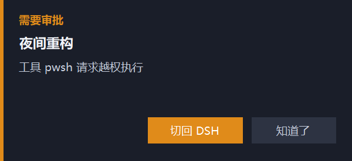

# dsh-attention-notify

> 会话需要你**审批**、或出现**需要你选择/回答的选项**时，在屏幕右上角弹出一个**始终置顶的系统小窗**，播放提示音，并能一键跳回那个会话。

这是一个 DSH（DeepSeek Harness）**插件 + skill** 二合一仓库：

- 把仓库目录交给 `dsh plugin add` → 装上提醒插件；
- 把仓库目录放进 `$DSH_HOME/skills/` → 变成一个可被智能体调用的 skill（[SKILL.md](SKILL.md)）。



## 为什么不是普通的网页弹窗

网页里的浮层只能在 DSH 自己的窗口内显示，窗口被别的应用盖住就看不见。
浏览器本身有两条“系统级”通道，实测结论：

| 方案 | 结果 |
| --- | --- |
| Document Picture-in-Picture（浏览器内置置顶窗） | ❌ 这个 Electron 壳没实现：`requestWindow()` 抛 `InvalidStateError: … Internal error: no window`（DSH 0.2.2-rc.1 / Electron 44.7.0 实测） |
| Electron `BrowserWindow` + `setAlwaysOnTop` | ❌ 宿主插件跑在 `ELECTRON_RUN_AS_NODE` 子进程里，拿不到窗口 API |
| **独立进程的 WinForms 置顶窗** | ✅ 本仓库的方案 |

## 平台支持

| 平台 | 置顶小窗 | 系统通知 | 应用内卡片 + 提示音 | 会话跳转 |
| --- | --- | --- | --- | --- |
| **Windows** | ✅ WinForms + `WS_EX_TOPMOST` | ✅ | ✅ | ✅ |
| **macOS / Linux** | ❌（没有等价的原生窗口通道） | ✅ | ✅ | ✅ |

宿主端在非 Windows 上直接跳过小窗进程，路由照常回 `{"ok":true,"helper":false}`，页面据此退回系统通知，不会报错也不会反复尝试。

**skill 文档本身是跨平台的**（`SKILL.md` 只是一份说明）；只有“置顶窗口”这项能力是 Windows 专属。

## 组成

```
lib/client.js            页面端：订阅待办交互、卡片、提示音、推送宿主、会话跳转
index.js                 宿主端：/attention-notify 路由、拉起/收起小窗进程
helper/alert-window.ps1  置顶小窗：WinForms + WS_EX_TOPMOST，独立 PowerShell 进程
tests/render.test.mjs    无 React/无浏览器的行为测试
tools/asar.mjs           只读探查工具：列出/提取 app.asar 内容
SKILL.md / REFERENCE.md  skill 说明与实现细节
```

数据流：

```
页面 --POST /attention-notify/notify--> 宿主 --写%TEMP%\dsh-attention-notify\alert.json--> 小窗(轮询显示)
```

页面用**相对路径**请求：浏览器直连本机服务器，桌面壳把 `dsh-app://app` 下未知路径带 cookie 转发到同一台服务器，所以不需要知道端口。

## 安装为插件

```powershell
dsh plugin --profile desktop add <本仓库路径>
```

然后重载一次宿主端（页面端会自动热替换）：

```
plugin_manager  set_bundle  dsh-attention-notify  enabled=false
plugin_manager  set_bundle  dsh-attention-notify  enabled=true
```

## 安装为 skill

把本仓库目录（含 `SKILL.md`）链接到 DSH 的 skills 目录即可：

```powershell
# Windows：junction，不需要管理员或开发者模式
cmd /c mklink /J "%DSH_HOME%\skills\dsh-attention-notify" <本仓库路径>
```

```bash
# macOS / Linux
ln -s <本仓库路径> "$DSH_HOME/skills/dsh-attention-notify"
```

链接后智能体在“要审批提醒 / 置顶弹窗”这类请求下会加载它（本机已用 junction 注册过，可直接验证）。

## 行为

- **置顶**：`WS_EX_TOPMOST`，被浏览器、资源管理器盖住也看得见。
- **不抢焦点**：`ShowWithoutActivation`，你在别的窗口打字不被打断；点它才激活。
- **按真实 DPI 渲染**：声明 Per-Monitor V2 DPI 感知 + ClearType，150% 缩放下窗口是 600×276 物理像素而不是被拉伸的 400×184。
- **重发**：请求挂起期间每 30 秒再提醒一次（最多 3 次）。
- **按钮**：「切回 DSH」把主窗口拉到前面；应用内卡片上的「打开会话」走 `ctx.uiWorkspace.openSession(sessionId)` 真正切会话。
- **回退**：路由不可达时退回 Windows 通知，再退回应用内卡片 + 提示音。
- **生命周期**：小窗第一次需要时启动，宿主卸载或 dsh 退出时结束；`%TEMP%\dsh-attention-notify\stop` 可手动叫停。

## 调参

| 想改 | 文件 | 位置 |
| --- | --- | --- |
| 尺寸/字体/配色/位置 | `helper/alert-window.ps1` | `S()`、`$cardWidth`、字体 |
| 重发间隔/次数 | `lib/client.js` | `REFRESH_MS`、`MAX_REFRESHES` |
| 卡片停留/数量 | `lib/client.js` | `CARD_LIFETIME_MS`、`MAX_CARDS` |
| 中英文案 | `lib/client.js` | `zh` / `en` 字典 |

`lib/client.js` 改完半秒热替换；`index.js`、`helper/` 改动需要重载插件或重启应用。

## 自检

```powershell
node tests/render.test.mjs
Invoke-WebRequest http://127.0.0.1:<port>/attention-notify/ping
```

页面控制台：`__DSH_ATTENTION_NOTIFY__.test()`。

## 限制

- 仅 Windows（小窗用 WinForms）。
- 同一会话同时存在多个请求时，`sessionStatus` 只发布优先级最高的一个。
- 系统通知受 Windows 通知设置 / 专注助手影响。

## License

MIT
